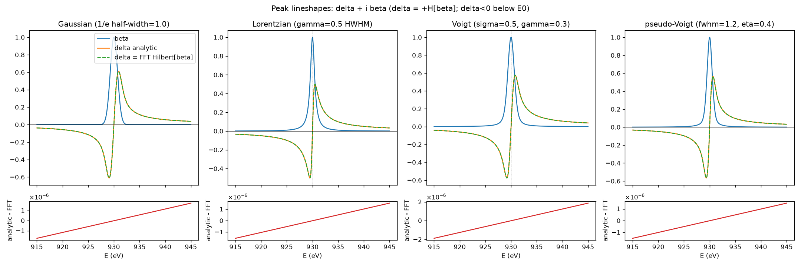
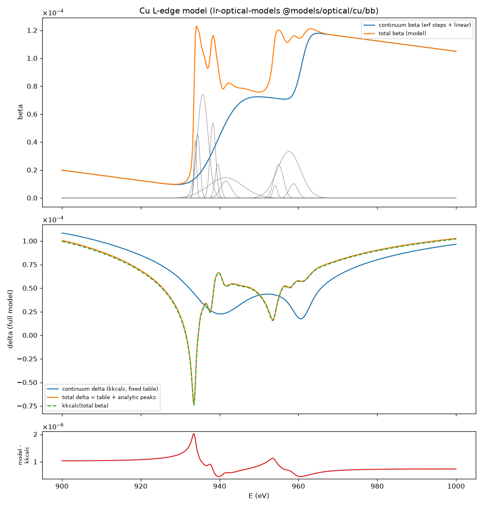

# Validation

The test suite (`pytest`, plus `cargo test`) checks the Rust implementation against independent references.
The same tests run on the pure-numpy reference port and on the compiled package.

| Check | Limit | Observed |
|---|---|---|
| Analytic $\delta$ against an FFT Hilbert transform of $\beta$, all four lineshapes | < 5e-6 | about 2e-6 |
| Rust against the numpy reference | rtol 1e-12 | machine precision |
| Voigt with $\gamma\to0$ against the Gaussian, $\sigma\to0$ against the Lorentzian | < 1e-6, < 1e-5 | 5e-7, 3e-6 |
| Thompson-Cox-Hastings pseudo-Voigt against the exact Voigt | < 2.5e-2 | 1.8e-2 |
| Cu L-edge full model against kkcalc2 on the total $\beta$ | < 2.5e-2 of max, < 2.5e-6 abs | 2.0e-2, about 1e-6 |
| Random models (peaks, scale, shift), 30 per size | 1e-12 | passes |

## Analytic $\delta$ against the numerical Hilbert transform

Amplitude 1. Residual rows are analytic minus FFT; the slow linear drift is the finite window of the numerical transform.

## Full Cu L-edge model against kkcalc2

Gaussian peaks with analytic $\delta$, on a kkcalc2 continuum table, against kkcalc2 applied to the total
$\beta$. The remainder is a near-constant offset of about 1e-6 against a $\delta$ of order 1e-4.

The kkcalc2 version is pinned to one commit for the tests. Its output scales with the `density`
argument, so tests use `density=1.0` (see [Concepts](concepts.md#the-continuum)).

## Speed

Speed tests require the Rust package to be no slower than the numpy reference, timed in the same
run. Typical single-core results on 4001 points: Gaussian 2.7×, Lorentzian 1.9×, Voigt 1.6×, pseudo-Voigt 4.2×,
a Cu model with 11 peaks and two steps 2.9× (170 µs). `python -m benchmarks.bench` reproduces the table.
